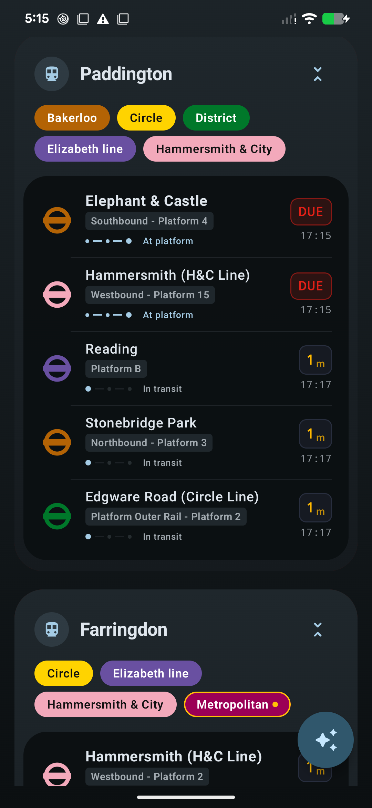
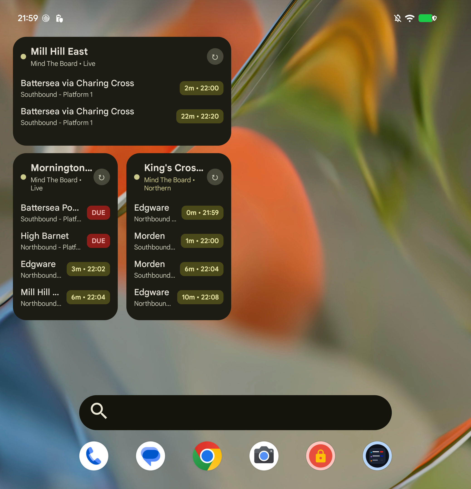

# Prompt Departure 🚇

A modern, high-performance London transit departure board app built for Android with **Jetpack Compose**, **Material 3 Expressive**, and **Glance AppWidgets**. Powered by the **Transport for London (TfL) Unified API** and **National Rail Darwin Live Feeds**.

[](https://developer.android.com)
[](https://developer.android.com/jetpack/compose)
[](LICENSE.md)
[](https://play.google.com/store/apps/details?id=com.androidfung.departureboard)

*Download now on the [Google Play Store](https://play.google.com/store/apps/details?id=com.androidfung.departureboard).*

---

## 📸 Screenshots

<p align="center">
  
  
  
  
  
</p>

---

## ✨ Features

- **🔴 Unified Real-Time Departures & Scheduled Times:**
  - Live countdown predictions formatted in a clean, elevated Material 3 design alongside exact scheduled clock arrival times (e.g. `18:02`, `18:14`).
  - Live train track progression indicators (*Approaching*, *At Platform*, *In Transit*) and intelligent status badges (*DUE*, *Delayed*, *Cancelled*).
- **🚆 Complete Network Coverage & Official TfL Roundels:**
  - Full multi-modal coverage: **London Underground**, **Elizabeth line**, **London Overground** (including all 6 2024 named lines: Liberty, Lioness, Mildmay, Suffragette, Weaver, Windrush), **National Rail**, **DLR**, **London Buses**, and **Trams**.
  - **National Rail Calling Points:** Downstream station calling points with live estimated and scheduled departure times.
  - **Smart Direction & Terminus Filtering:** Tap any line badge to filter departures; through-stations cycle through cardinal directions (`→ EB`, `← WB`, etc.), while terminus stations toggle directly without redundant direction cycling.
- **🔔 Live Notification Journey Tracking (Android 16 Live Updates):**
  - Pin any train or bus to your status bar and lock screen with Android 16's **Promoted Ongoing Notifications** (`POST_PROMOTED_NOTIFICATIONS`).
  - Glanceable status chip text (e.g., `8 min`, `1 min`, `Due`) that continuously updates without cluttering the notification drawer.
- **🤖 Intelligent Hybrid Transit AI Assistant:**
  - Natural language commuter assistant powered by **On-Device Gemini Nano** (via Android ML Kit Prompt API) with cloud fallback via **Firebase AI Logic (Gemini 1.5 Flash)**.
  - Resolves natural language queries, colloquial names, and station typos (e.g., *"when is the next Mill Hill East train from Bank"* or *"Heathrow T5 from Farringdon"*).
  - Automatically queries live TfL line statuses, disruptions, and delays with one-tap Suggested Questions tailored to the user's nearest station.
- **⚡ Interactive Home Screen Widgets (Glance):**
  - Live London departure boards directly on your Android home screen.
  - **Per-Widget Station & Line Filtering:** Dedicate widgets to a specific station and route (e.g. show *only* the Northern line at King's Cross or bus route *221* at your local bus stop).
  - **Direct Deep-Linking:** Tapping any widget opens the app straight into that station's detailed live departures sheet.
  - Interactive manual refresh button with automated background synchronization via **WorkManager**.
- **📍 Location-Aware Near-Me Sorting:**
  - Automatically identifies and flags your nearest saved station with walking distance in meters using Google Play Services Location (`FusedLocationProviderClient`).
- **🔀 Smooth Drag & Drop Customization:**
  - Reorder saved stations effortlessly with custom animated drag-and-drop grid gestures.
- **🎨 Edge-to-Edge & Adaptive Layouts:**
  - Full edge-to-edge support with dynamic system bar insets.
  - Adaptive grid hierarchy designed for phones, foldables, and tablets.

---

## 🛠️ Tech Stack & Architecture

- **UI:** [Jetpack Compose](https://developer.android.com/jetpack/compose) with Material 3 Expressive design tokens.
- **AI / Generative Model:** Hybrid on-device **Gemini Nano** ([ML Kit GenAI Prompt API](https://developers.google.com/ml-kit)) + Cloud **Gemini 1.5 Flash** ([Firebase AI Logic](https://firebase.google.com/docs/ai-logic)).
- **Widgets:** [Glance AppWidget](https://developer.android.com/jetpack/compose/glance) backed by DataStore Preferences.
- **Architecture:** Unidirectional Data Flow (MVI/MVVM), Kotlin Coroutines & `StateFlow`.
- **Networking:** [Retrofit 2](https://square.github.io/retrofit/) + [Moshi](https://github.com/square/moshi) with Kotlin code-generation (KSP).
- **Persistence:** [Room Database](https://developer.android.com/training/data-storage/room) for instantaneous offline caching & [Jetpack DataStore](https://developer.android.com/topic/libraries/architecture/datastore) (Preferences DataStore).
- **Background Work:** [AndroidX WorkManager](https://developer.android.com/topic/libraries/architecture/workmanager) for periodic background widget updates.
- **Location:** Google Play Services Location (`FusedLocationProviderClient`).
- **Billing:** Google Play Billing Library (PBL v9) with `FREE`, `PRO`, and `MAX` tiers.

---

## 🚀 Getting Started

### Prerequisites
- Android Studio Ladybug / Meerkat or newer
- JDK 17
- Android SDK 35+ (target SDK 37)

### 1. Clone the repository
```bash
git clone https://github.com/seventhmoon/DepartureBoard-Android.git
cd DepartureBoard-Android
```

### 2. Configure API Keys
This project uses `local.properties` so private API credentials are **never committed to source control**.

1. Copy `local.properties.example` to `local.properties`:
   ```bash
   cp local.properties.example local.properties
   ```
2. Add your API keys:
   - Obtain a free TfL key from the [TfL Open Data Portal](https://api-portal.tfl.gov.uk/).
   - (Optional) Obtain a National Rail Open Data key from [National Rail Open Data](https://opendata.nationalrail.co.uk/).
   ```properties
   sdk.dir=/path/to/your/Android/sdk
   TFL_API_KEY=your_tfl_api_key_here
   NATIONAL_RAIL_API_KEY=your_national_rail_api_key_here
   ```

### 3. Build & Run
Run the unit test suite:
```bash
./gradlew testDebugUnitTest
```

Build the debug APK:
```bash
./gradlew assembleDebug
```

---

## 📄 License

This project is licensed under the terms of the **GNU General Public License v3.0** (GPLv3). See [LICENSE.md](LICENSE.md) for the full license text.
