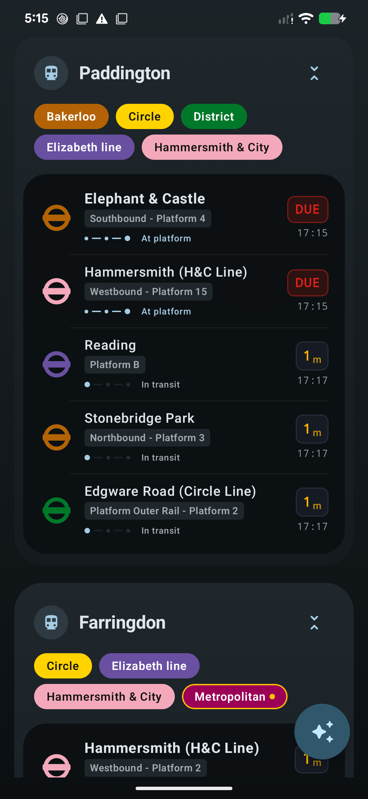
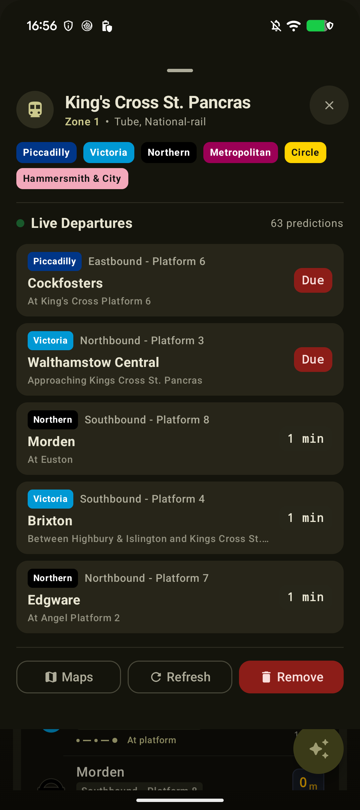
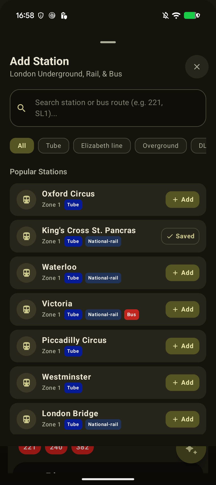
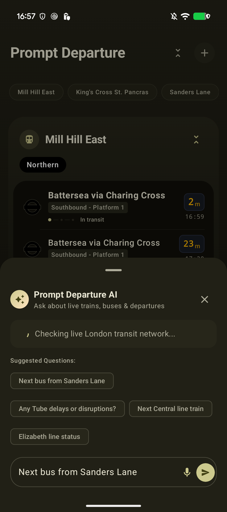
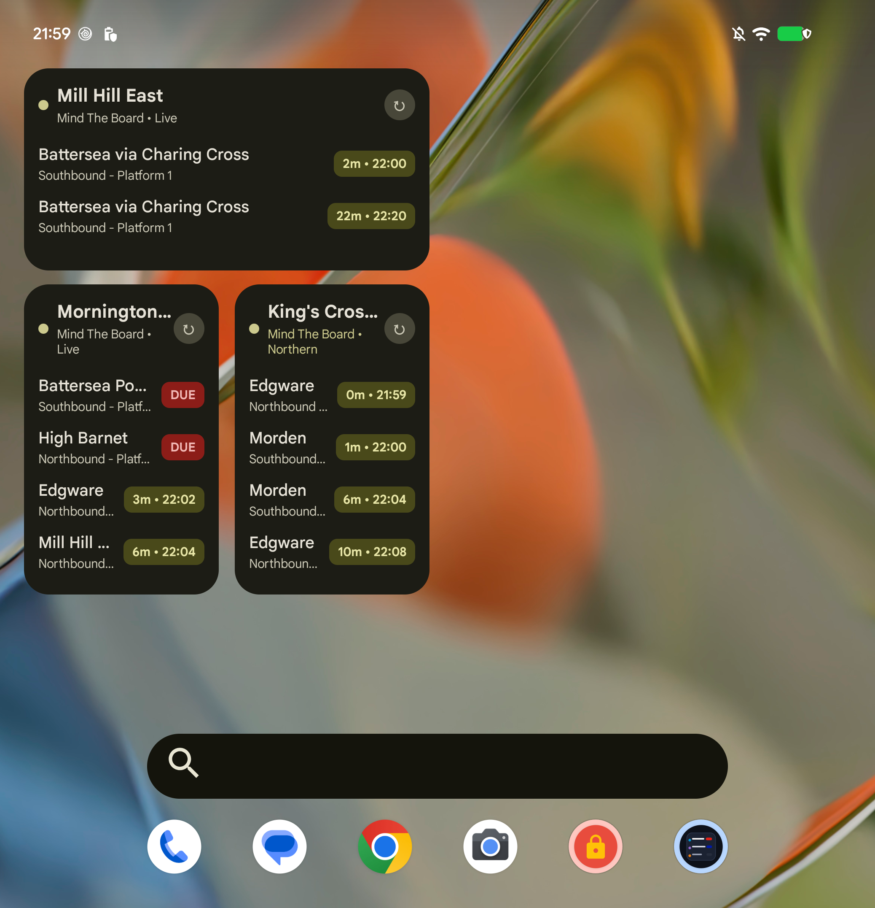

# EkiBoard 🚇

A modern, high-performance multi-region transit departure board app built for Android with **Jetpack Compose**, **Material 3 Expressive**, and **Glance AppWidgets**. Designed for commuters across **London & UK**, **Hong Kong**, **Singapore**, **Sydney**, and **Tokyo**.

[](https://github.com/seventhmoon/DepartureBoard-Android/actions/workflows/ci.yml)
[](https://developer.android.com)
[](https://developer.android.com/jetpack/compose)
[](LICENSE.md)
[](https://play.google.com/store/apps/details?id=com.androidfung.departureboard)

*Download now on the [Google Play Store](https://play.google.com/store/apps/details?id=com.androidfung.departureboard).*

---

## 📸 Screenshots

<p align="center">
  
  
  
  
  
</p>

---

## 🌍 Supported Regions & Transit Networks

- **🇬🇧 United Kingdom (`GB`):**
  - **Transport for London (TfL):** London Underground (11 lines), Elizabeth line, London Overground (all 6 named lines: *Liberty*, *Lioness*, *Mildmay*, *Suffragette*, *Weaver*, *Windrush*), DLR, London Trams, and London Buses.
  - **National Rail:** Live Darwin departure feeds and route topologies (including Thameslink, Southern, Southeastern, Great Northern, and South Western Railway).
  - **UK National Buses:** Bus Open Data Service (BODS) SIRI-VM live vehicle and stop predictions.
- **🇭🇰 Hong Kong (`HK`):**
  - **MTR & Light Rail:** Real-time next-train arrivals across all 10 MTR heavy rail lines and Light Rail routes.
  - **Franchised Buses:** Unified real-time ETAs across **KMB**, **LWB**, **Citybus (CTB)**, and **New Lantao Bus (NLB)** with full bilingual (*English / Traditional Chinese*) support.
- **🇸🇬 Singapore (`SG`):**
  - **MRT & LRT:** North-South, East-West, North East, Circle, Downtown, and Thomson-East Coast MRT lines plus Bukit Panjang, Sengkang, and Punggol LRT networks with official station codes.
  - **LTA Buses:** Live bus arrival predictions, load indicators, and vehicle types.
- **🇦🇺 Australia (`AU` — Sydney & NSW):**
  - **Transport for NSW:** Sydney Metro (`M1`), Sydney Trains suburban network (`T1`–`T9`), Intercity services (*Blue Mountains*, *Central Coast & Newcastle*, *South Coast*, *Southern Highlands*, *Hunter*), and Sydney Ferries (`F1`–`F9`).
- **🇯🇵 Japan (`JP` — Tokyo):**
  - **Tokyo Metro, Toei Subway & JR East:** All 9 Tokyo Metro lines, 4 Toei Subway lines, and major JR East commuter lines (*Yamanote*, *Chuo Rapid*, *Chuo-Sobu*, *Keihin-Tohoku*, *Saikyo*, *Shonan-Shinjuku*, *Joban*, *Keiyo*, *Yokosuka-Sobu*) with official alphanumeric station numbering (e.g., `G01`, `JY01`) and bilingual (*English / Japanese*) station names.

---

## ✨ Key Features

- **🔴 Unified Real-Time Departures & Scheduled Times:**
  - Live countdown predictions in an elevated Material 3 Expressive layout alongside exact scheduled clock times (e.g., `18:02`, `18:14`).
  - Live train progression indicators (*Approaching*, *At Platform*, *In Transit*) and status badges (*DUE*, *Delayed*, *Cancelled*).
- **🎯 Accurate Terminus & Downstream Calling Points:**
  - **Terminus Arrival Scrubbing:** Automatically filters out terminating arrival predictions at terminus and shuttle stations (such as *Mill Hill East*) so only genuine outbound departures are shown.
  - **Ordered Calling Point Resolution:** Standardized station-code route topology resolves downstream calling points across linear, multi-branch, spiral (e.g., London *Circle line*), and true continuous loop lines (e.g., Tokyo *JR Yamanote Line*).
  - **Smart Direction & Platform Filtering:** Tap any line badge to filter departures; through-stations cycle through directions (`→ EB`, `← WB`, etc.), while terminus stations toggle directly.
- **🔔 Live Notification Journey Tracking (Android 16 Live Updates):**
  - Pin any train or bus to your status bar and lock screen with Android 16's **Promoted Ongoing Notifications** (`POST_PROMOTED_NOTIFICATIONS`).
  - Glanceable status chip text (`8 min`, `1 min`, `Due`) that updates automatically in the background.
- **🤖 Intelligent Hybrid Transit AI Assistant:**
  - Natural language commuter assistant powered by **On-Device Gemini Nano** (via Android ML Kit GenAI Prompt API) with cloud fallback via **Firebase AI Logic (Gemini)**.
  - Resolves natural language queries, colloquial names, and station typos with live service status and disruption awareness.
- **⚡ Interactive Home Screen Widgets (Glance):**
  - Live departure boards directly on your Android home screen with per-widget station and line filtering, direct deep-linking, manual refresh, and periodic **WorkManager** synchronization.
- **📍 Location-Aware Near-Me Sorting & Drag-and-Drop Customization:**
  - Automatically identifies and flags your nearest saved station with walking distance using `FusedLocationProviderClient`, paired with smooth animated drag-and-drop grid reordering.
- **🎨 Suspended LED Sign Adaptive Icon & Edge-to-Edge UI:**
  - Custom adaptive launcher icon modeled after a suspended station platform LED matrix sign with full Android 13+ Material You monochrome themed icon support.
  - Adaptive multi-column layouts across phones, foldables, and tablets.

---

## 🏗️ Architecture & Code Structure

EkiBoard uses a unified, multi-region domain architecture designed for high code reuse and testability:

- **[`TransitLineDefinition`](app/src/main/java/com/androidfung/departureboard/data/model/TransitLineDefinition.kt) & [`TransitLineRegistry`](app/src/main/java/com/androidfung/departureboard/data/model/TransitLineDefinition.kt):** Shared contract for all regional transit lines ([`GbTransitLine`](app/src/main/java/com/androidfung/departureboard/data/model/gb/GbTransitLine.kt), [`HkMtrLine`](app/src/main/java/com/androidfung/departureboard/data/model/hk/HkMtrLine.kt), [`SgMrtLine`](app/src/main/java/com/androidfung/departureboard/data/model/sg/SgMrtLine.kt), [`AuSydneyLine`](app/src/main/java/com/androidfung/departureboard/data/model/au/AuSydneyLine.kt), [`JpTokyoLine`](app/src/main/java/com/androidfung/departureboard/data/model/jp/JpTokyoLine.kt)) providing localized names, brand colors, transport modes, and fast case-insensitive lookup.
- **[`BaseStationDirectory`](app/src/main/java/com/androidfung/departureboard/data/model/StationDirectory.kt) & [`StationSearchRanker`](app/src/main/java/com/androidfung/departureboard/data/model/StationDirectory.kt):** Generic station directory with O(1) station ID indexing and unified multi-field search ranking across English, local scripts, and station codes.
- **[`TransitLineNetwork`](app/src/main/java/com/androidfung/departureboard/data/topology/TransitLineNetwork.kt) & [`LinearRouteCallingPointsResolver`](app/src/main/java/com/androidfung/departureboard/data/topology/LinearRouteCallingPointsResolver.kt):** Standardized station-code route topology across [`GbTransitRoutes`](app/src/main/java/com/androidfung/departureboard/data/model/gb/topology/GbTransitRoutes.kt), [`HkMtrRoutes`](app/src/main/java/com/androidfung/departureboard/data/model/hk/HkMtrRoutes.kt), [`SgMrtRoutes`](app/src/main/java/com/androidfung/departureboard/data/model/sg/SgMrtRoutes.kt), [`AuSydneyRoutes`](app/src/main/java/com/androidfung/departureboard/data/model/au/AuSydneyRoutes.kt), and [`JpTokyoRoutes`](app/src/main/java/com/androidfung/departureboard/data/model/jp/JpTokyoRoutes.kt).
- **[`RegionalTransitProvider`](app/src/main/java/com/androidfung/departureboard/data/repository/region/RegionalTransitProvider.kt) & Composite Regional Architecture:** Strategy interface encapsulating region-specific departure sources, multi-feed reconciliation (e.g. [`GbFeedReconciliationEngine`](app/src/main/java/com/androidfung/departureboard/data/repository/region/gb/GbFeedReconciliationEngine.kt) combining TfL, National Rail, and BODS), and downstream calling points under regional packages (`region/gb`, `region/hk`, `region/sg`, `region/au`, `region/jp`).
- **[`AppContainer`](app/src/main/java/com/androidfung/departureboard/di/AppContainer.kt):** Centralized dependency injection container managing regional providers, API clients, and database singletons.
- **Modular UI Feature Structure:** Clear separation of concerns organized into `ui/feature/{detail, search, settings, paywall, ai}`, `ui/dashboard/`, `ui/designsystem/`, and `ui/ads/`.
- **[`CoalescingTimedCache`](app/src/main/java/com/androidfung/departureboard/util/CoroutineResultUtils.kt) (`SingleFlight`):** Thread-safe in-memory TTL cache and request coalescer that deduplicates concurrent network requests and preserves cancellation semantics via `runSuspendCatching`.

### Tech Stack
- **UI:** [Jetpack Compose](https://developer.android.com/jetpack/compose) with Material 3 Expressive design tokens.
- **AI / Generative Model:** On-device **Gemini Nano** ([ML Kit GenAI Prompt API](https://developers.google.com/ml-kit)) + Cloud **Firebase AI Logic** (dynamic feature module `:features:ai_assistant`).
- **Widgets:** [Glance AppWidget](https://developer.android.com/jetpack/compose/glance) backed by DataStore Preferences.
- **Networking:** [Retrofit 2](https://square.github.io/retrofit/) + [Moshi](https://github.com/square/moshi) with Kotlin code-generation (KSP).
- **Persistence:** [Room Database](https://developer.android.com/training/data-storage/room) & [Jetpack DataStore](https://developer.android.com/topic/libraries/architecture/datastore).
- **Background Work:** [AndroidX WorkManager](https://developer.android.com/topic/libraries/architecture/workmanager).
- **Billing:** Google Play Billing Library (PBL v9) with `FREE`, `PRO`, and `MAX` tiers.

---

## 🚀 Getting Started

### Prerequisites
- Android Studio Ladybug / Meerkat or newer
- JDK 17+
- Android SDK 35+ (Target SDK 37)

### 1. Clone the repository
```bash
git clone https://github.com/seventhmoon/DepartureBoard-Android.git
cd DepartureBoard-Android
```

### 2. Configure API Keys
This project uses `local.properties` so private API credentials are **never committed to source control**.

1. Copy `local.properties.example` to `local.properties`:
   ```bash
   cp local.properties.example local.properties
   ```
2. Add your API keys:
   - Obtain a free TfL key from the [TfL Open Data Portal](https://api-portal.tfl.gov.uk/).
   - (Optional) Obtain a National Rail Open Data key from [National Rail Open Data](https://opendata.nationalrail.co.uk/).
   - (Optional) Obtain a Bus Open Data Service key from [BODS Open Data](https://data.bus-data.dft.gov.uk/).
   ```properties
   sdk.dir=/path/to/your/Android/sdk
   TFL_API_KEY=your_tfl_api_key_here
   NATIONAL_RAIL_API_KEY=your_national_rail_api_key_here
   BODS_API_KEY=your_bods_api_key_here
   ```

### 3. Build & Run
Run the unit test suite:
```bash
./gradlew testDebugUnitTest
```

Build the debug APK:
```bash
./gradlew assembleDebug
```

---

## 📄 License

This project is licensed under the terms of the **GNU General Public License v3.0** (GPLv3). See [LICENSE.md](LICENSE.md) for the full license text.
